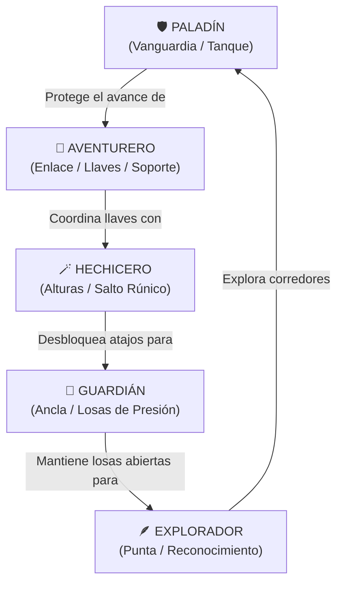

# 25. Hojas de Personaje Oficiales: Las 5 Clases de Héroes de Runa y Piedra

Este documento constituye la guía canónica y compendio de **Hojas de Personaje** para los 5 héroes de *Runa y Piedra*. Integra la especificación narrativa, trasfondo (*lore*), parámetros numéricos del motor de físicas, arquitectura del modelo 3D vóxel y tácticas cooperativas para partidas de hasta 5 jugadores.

---

## 1. Resumen Comparativo de la Expedición

En *Runa y Piedra*, cada expedición admite un máximo de **5 jugadores simultáneos**, rigiéndose por el principio estricto de **unicidad absoluta de clase** (una raza/clase única por aventurero). La composición completa de la party abarca la totalidad del elenco:

| Clase / Héroe | Título Oficial | Rol Táctico | Color | Icono | Mult. Vel | Mult. Salto | Altura Salto | Defensa | Dificultad |
| :--- | :--- | :--- | :---: | :---: | :---: | :---: | :---: | :---: | :---: |
| [**Aventurero**](#hoja-1-aventurero) | Explorador Versátil | Equilibrado / Enlace | `#38bdf8` | `compass` (🧭) | $1.00\times$ ($4.80\text{ m/s}$) | $1.00\times$ ($7.20\text{ m/s}$) | $1.30\text{ m}$ | 3 / 5 | Equilibrado |
| [**Paladín**](#hoja-2-paladín) | Caballero de la Luz | Vanguardia / Tanque | `#f43f5e` | `shield` (🛡️) | $0.96\times$ ($4.61\text{ m/s}$) | $0.98\times$ ($7.06\text{ m/s}$) | $1.24\text{ m}$ | 5 / 5 | Resistente |
| [**Explorador**](#hoja-3-explorador) | Rastreador Veloz | Agilidad / Punta | `#10b981` | `feather` (🪶) | **$1.12\times$** ($5.38\text{ m/s}$) | $1.04\times$ ($7.49\text{ m/s}$) | $1.40\text{ m}$ | 2 / 5 | Veloz |
| [**Hechicero**](#hoja-4-hechicero) | Mago Arcano | Salto / Alturas | `#a855f7` | `wand` (🪄) | $0.98\times$ ($4.70\text{ m/s}$) | **$1.14\times$** ($8.21\text{ m/s}$) | **$1.68\text{ m}$** | 2 / 5 | Técnico |
| [**Guardián**](#hoja-5-guardián) | Baluarte Ancestral | Ancla / Estabilidad | `#fbbf24` | `crown` (👑) | $0.94\times$ ($4.51\text{ m/s}$) | $0.96\times$ ($6.91\text{ m/s}$) | $1.19\text{ m}$ | 5 / 5 | Estratégico |

> [!NOTE]
> **Fórmulas Físicas del Motor (`SimulationEngine.js`):**
> - Velocidad horizontal: $v_{\text{horiz}} = 4.80 \times \text{speedMultiplier}\text{ m/s}$.
> - Velocidad inicial de salto: $v_y = 7.20 \times \text{jumpMultiplier}\text{ m/s}$.
> - Altura máxima alcanzada sobre el suelo: $h_{\max} = \frac{v_y^2}{2 \times |g|} = \frac{v_y^2}{40}\text{ m}$ (con $g = -20\text{ m/s}^2$).
> - Todos los héroes superan con holgura el bloque unitario de $1.0\text{ m}$, garantizando que ningún personaje quede atascado en la geometría estándar.

---

## Hoja 1: Aventurero

```
═══════════════════════════════════════════════════════════════════════
   HOJA DE PERSONAJE: AVENTURERO (EXPLORADOR VERSÁTIL)
═══════════════════════════════════════════════════════════════════════
```

### 1. Identidad y Trasfondo
* **Nombre de Clase:** Aventurero (`adventurer`)
* **Índice en Registro:** `0`
* **Título:** Explorador Versátil
* **Color Distintivo:** Azul Cian (`#38bdf8` / `0x38bdf8`)
* **Emblema SVG:** `compass` (🧭 Brújula Rúnica de Expedición)
* **Lema:** *"Ningún camino está cerrado para quien sabe leer la piedra."*
* **Biografía:** Veterano de incontables expediciones subterráneas. Curtido en los corredores oscuros de templos olvidados, su instinto agudizado le permite adaptarse con soltura a trampas imprevistas, plataformas colgantes y mecanismos milenarios. No depende de magia pesada ni de armaduras sofocantes; su mayor virtud es la versatilidad absoluta.

---

### 2. Parámetros Físicos y Atributos

```
   VELOCIDAD:   [■■■■■■■■■□]  1.00x  (4.80 m/s)
   SALTO:       [■■■■■■■■■□]  1.00x  (7.20 m/s | 1.30 m)
   DEFENSA:     [■■■■■■□□□□]  3 / 5  (Equilibrada)
   VIDAS:       [❤️❤️❤️]      3 / 3  (60 ticks invulnerabilidad)
   DIFICULTAD:  Equilibrado (Ideal para iniciarse y liderar)
```

* **Velocidad de carrera:** $4.80\text{ m/s}$ ($100\%$ base). Respuesta neutra e intuitiva.
* **Física de salto:** $7.20\text{ m/s}$ de impulso vertical, alcanzando una cota máxima de $1.30\text{ m}$.
* **Inercia y tracción:** Coeficiente estándar sin sobreviraje. Control aéreo predecible en saltos cruzados.

---

### 3. Rasgo Pasivo: *Instinto Explorador*
* **Efecto de Juego:** Equilibrio perfecto entre agilidad y destreza en laberintos.
* **Impacto en Simulación:** No sufre penalizaciones de inercia por armadura pesada ni la flotabilidad excesiva de los magos. Su tiempo de respuesta en cambios rápidos de dirección es el estándar dorado del motor, facilitando correcciones milimétricas en cornisas estrechas.

---

### 4. Equipamiento Visual 3D (`adventurerGear.js`)
* **Prenda de Hombros:** Capucha de viaje en tejido avellana (`#8b5a2b`) reposando sobre los omóplatos.
* **Cuello:** Bufanda/pañuelo de cuero fino (`#6b4423`) ceñido para protegerse del polvo de las catacumbas.
* **Espalda y Pecho:** Mochila de viaje con correas de cuero oscuro cruzadas al frente sobre el torso.
* **Cintura:** Dos bolsas utilitarias laterales (`#6b4423`) para ganzúas, mapas y brújulas auxiliares.
* **Pecho:** Brújula rúnica dorada de latón (`#c9a227`) que reacciona con sutil brillo ante las corrientes de aire.
* **Piernas:** Botas de cuero reforzado (`#3d2817`) emparentadas dinámicamente a los pivotes de las piernas (`legLPivot` / `legRPivot`) para marcha síncrona a 60 FPS.
* **Cabeza:** Casquete de cabello castaño natural con un mechón rebelde frontal.

---

### 5. Rol Táctico y Sinergias Cooperativas
* **Posición en el Grupo:** Medio campo / Portador de Llaves / Enlace.
* **Tareas Principales:**
  1. Recoger llaves (`llave_tutorial`, `llave_santuario`) y operar cerraduras con agilidad.
  2. Apoyar la vanguardia cuando se requiere activar una losa secundaria.
  3. Servir de punto de referencia espacial para los jugadores rezagados.
* **Sinergia con otros Héroes:**
  - **Con el Paladín:** Avanza justo tras su escudo para abrir puertas inmediatamente al llegar.
  - **Con el Hechicero:** Se beneficia de las rutas descubiertas por el mago para acceder rápidamente por tierra.

---

## Hoja 2: Paladín

```
═══════════════════════════════════════════════════════════════════════
   HOJA DE PERSONAJE: PALADÍN (CABALLERO DE LA LUZ)
═══════════════════════════════════════════════════════════════════════
```

### 1. Identidad y Trasfondo
* **Nombre de Clase:** Paladín (`paladin`)
* **Índice en Registro:** `1`
* **Título:** Caballero de la Luz
* **Color Distintivo:** Carmesí Sagrado (`#f43f5e` / `0xf43f5e`)
* **Emblema SVG:** `shield` (🛡️ Escudo de la Fe y Bastión)
* **Lema:** *"La luz guía mis pasos; mi escudo protegerá a los caídos."*
* **Biografía:** Miembro juramentado de la Sagrada Orden de la Llama Radiante. Porta una pesada armadura forjada en aleación de acero y oro bendecido. Lidera siempre la vanguardia de la expedición, absorbiendo los riesgos de pasadizos inexplorados para garantizar que sus compañeros lleguen ilesos a la cámara ceremonial.

---

### 2. Parámetros Físicos y Atributos

```
   VELOCIDAD:   [■■■■■■■■□□]  0.96x  (4.61 m/s)
   SALTO:       [■■■■■■■■□□]  0.98x  (7.06 m/s | 1.24 m)
   DEFENSA:     [■■■■■■■■■■]  5 / 5  (Blindaje Máximo)
   VIDAS:       [❤️❤️❤️]      3 / 3  (Alta Resiliencia)
   DIFICULTAD:  Resistente (Tolerante ante errores de posicionamiento)
```

* **Velocidad de carrera:** $4.61\text{ m/s}$ ($-4\%$ de cadencia debido al peso del acero).
* **Física de salto:** $7.06\text{ m/s}$ de impulso vertical ($1.24\text{ m}$ de altura libre). Supera cualquier foso de un bloque con firmeza.
* **Estabilidad:** Su masa reduce la sensibilidad ante rebotes bruscos en colisiones con esquinas.

---

### 3. Rasgo Pasivo: *Aura de Firmeza*
* **Efecto de Juego:** Pisada pesada e inamovible con máxima resiliencia en terreno rocoso.
* **Impacto en Simulación:** Menor dispersión lateral por inercia residual. Proporciona una marcha sumamente estable en pasillos angostos flanqueados por fosas de lava ardiente.

---

### 4. Equipamiento Visual 3D (`paladinGear.js`)
* **Yelmo:** Casco envolvente de placas de acero pulido (`#b8bcc4`) con visor abierto para mantener visión panorámica, cubrenuca y laterales protectores de orejas.
* **Cresta:** Penacho de plumas de crin escarlata (`#a01828`) montado sobre una sólida base de oro (`#d4af37`).
* **Hombreras:** Doble hombrera acorazada rectangular de acero templado (`#7a7f88`) con ribete dorado perimetral.
* **Escudo Heráldico:** Escudo masivo montado en el antebrazo izquierdo (`armLPivot`). Cuenta con marco de oro, umbo central prominente y una cruz dorada grabada; oscila naturalmente durante la marcha.
* **Coraza:** Pechera de acero con una cruz dorada en relieve en el centro del esternón.
* **Cinto:** Hebilla dorada maciza con acabado de forja ceremonial.

---

### 5. Rol Táctico y Sinergias Cooperativas
* **Posición en el Grupo:** Punta de Vanguardia / Tanque / Protector.
* **Tareas Principales:**
  1. Cruzar primero las puertas que se abren por primera vez.
  2. Explorar suelos sospechosos y verificar la presencia de fosas ocultas.
  3. Asegurar los puntos de cruce estrechos para que el resto del equipo avance sin precipitarse.
* **Sinergia con otros Héroes:**
  - **Con el Guardián:** Forman una muralla impenetrable cuando ambos activan losas de presión duales.
  - **Con el Explorador:** El Paladín asegura la sala mientras el Explorador sale disparado a recuperar gemas y cofres.

---

## Hoja 3: Explorador

```
═══════════════════════════════════════════════════════════════════════
   HOJA DE PERSONAJE: EXPLORADOR (RASTREADOR VELOZ)
═══════════════════════════════════════════════════════════════════════
```

### 1. Identidad y Trasfondo
* **Nombre de Clase:** Explorador (`ranger`)
* **Índice en Registro:** `2`
* **Título:** Rastreador Veloz
* **Color Distintivo:** Verde Esmeralda Forestal (`#10b981` / `0x10b981`)
* **Emblema SVG:** `feather` (🪶 Pluma Silvestre del Viento)
* **Lema:** *"Tan rápido como el viento, tan certero como la flecha."*
* **Biografía:** Cazador de bosques densos y explorador de grietas subterráneas. Dotado de una constitución atlética y reflejos sobresalientes, prescinde de protecciones pesadas para alcanzar velocidades vertiginosas. Es capaz de cruzar pasarelas que se derrumban y esquivar chorros de lava antes de que el peligro llegue a rozarle.

---

### 2. Parámetros Físicos y Atributos

```
   VELOCIDAD:   [■■■■■■■■■■]  1.12x  (5.38 m/s | Máxima)
   SALTO:       [■■■■■■■■■□]  1.04x  (7.49 m/s | 1.40 m)
   DEFENSA:     [■■■■□□□□□□]  2 / 5  (Armadura Ligera)
   VIDAS:       [❤️❤️❤️]      3 / 3  (Evasión Crítica)
   DIFICULTAD:  Veloz (Exige precisión y reflejos rápidos)
```

* **Velocidad de carrera:** **$5.38\text{ m/s}$** ($+12\%$ respecto al estándar). La mayor velocidad de toda la expedición.
* **Física de salto:** $7.49\text{ m/s}$ ($+4\%$). Al combinarse con su velocidad horizontal, su parábola de salto cubre una longitud horizontal hasta un $16\%$ mayor que la del Aventurero.
* **Alcance horizontal en fosa:** Cruza brechas de hasta $3.5\text{ metros}$ de longitud sin necesidad de losas de aceleración.

---

### 3. Rasgo Pasivo: *Paso del Viento*
* **Efecto de Juego:** Velocidad de movimiento mejorada (+12%) en corredores y pasillos.
* **Impacto en Simulación:** Permite atravesar zonas de peligro temporal (como plataformas que se hunden o puertas temporizadas) con una ventana de margen inalcanzable para otros héroes.

---

### 4. Equipamiento Visual 3D (`rangerGear.js`)
* **Capucha:** Casquete verde bosque (`#2a5a3a`) con laterales ceñidos a las sienes, cubrenuca y faldón posterior oscuro (`#1a3d26`) que ondea con el movimiento.
* **Capa:** Capa corta de paño élfico (`#2f6b42`) que desciende desde los hombros hasta la cintura, con ribete inferior de sombra para mayor dinamismo.
* **Carcaj de Cuero:** Tubo prismático de cuero reforzado (`#3a2410`) sobre el hombro derecho con anillas de fijación y 3 flechas con astil de fresno y plumas de vuelo carmesí vivo (`#c83226`).
* **Bandolera:** Correa de cuero cruzada diagonalmente sobre el pecho con hebilla utilitaria frontal.
* **Botas Altas:** Botas de montar de cuero curtido (`#3d2817`) articuladas en los pivotes de las piernas (`legLPivot` / `legRPivot`).
* **Guanteletes de Tiro:** Guantes de cuero oscuro en ambas manos para manipulación ágil.

---

### 5. Rol Táctico y Sinergias Cooperativas
* **Posición en el Grupo:** Exploración Adelantada / Flanqueo / Carrera de Botín.
* **Tareas Principales:**
  1. Correr por corredores largos para activar interruptores remotos.
  2. Alcanzar cofres secundarios distantes y regresar rápidamente con el grupo.
  3. Reconocer la ruta óptima a través de laberintos antes de que los miembros más lentos avancen.
* **Sinergia con otros Héroes:**
  - **Con el Guardián:** El Guardián mantiene pulsada una losa lejana mientras el Explorador cruza la puerta en un instante.
  - **Con el Hechicero:** Complementan los dos ejes de movilidad: el Explorador domina el plano horizontal y el Hechicero el vertical.

---

## Hoja 4: Hechicero

```
═══════════════════════════════════════════════════════════════════════
   HOJA DE PERSONAJE: HECHICERO (MAGO ARCANO)
═══════════════════════════════════════════════════════════════════════
```

### 1. Identidad y Trasfondo
* **Nombre de Clase:** Hechicero (`wizard`)
* **Índice en Registro:** `3`
* **Título:** Mago Arcano
* **Color Distintivo:** Violeta Místico (`#a855f7` / `0xa855f7`)
* **Emblema SVG:** `wand` (🪄 Varita y Báculo de Poder)
* **Lema:** *"La gravedad es solo un acuerdo que las runas pueden romper."*
* **Biografía:** Erudito consagrado al descifrado de las runas cósmicas y la manipulación de flujos gravitatorios. Mediante encantamientos transmitidos por los Primeros Constructores de las Criptas, el Hechicero puede alterar temporalmente la masa de su cuerpo para desafiar la atracción terrestre, alcanzando cotas y cornisas que parecen inalcanzables a simple vista.

---

### 2. Parámetros Físicos y Atributos

```
   VELOCIDAD:   [■■■■■■■■□□]  0.98x  (4.70 m/s)
   SALTO:       [■■■■■■■■■■]  1.14x  (8.21 m/s | 1.68 m Máximo)
   DEFENSA:     [■■■■□□□□□□]  2 / 5  (Túnica Mágica)
   VIDAS:       [❤️❤️❤️]      3 / 3  (Control Gravitatorio)
   DIFICULTAD:  Técnico (Exige cálculo preciso del tiempo de caída)
```

* **Velocidad de carrera:** $4.70\text{ m/s}$ ($-2\%$). Paso pausado, elegante y sereno.
* **Física de salto:** **$8.21\text{ m/s}$** ($+14\%$). El mayor salto de todo el juego.
* **Cota de elevación vertical:** Alcanza **$1.68\text{ metros}$** de altura libre (frente a los $1.30\text{ m}$ estándar), lo que le permite montar sobre bloques dobles mediante plataformas intermedias mínimas y acceder a balconadas elevadas.
* **Tiempo en el aire (*Hang Time*):** Su parábola aérea extendida facilita el ajuste del punto de caída en pleno vuelo.

---

### 3. Rasgo Pasivo: *Salto de Levitación*
* **Efecto de Juego:** Impulso de salto elevado (+14%) mediante suspensión rúnica momentánea.
* **Impacto en Simulación:** Transforma el diseño de los niveles: permite al grupo descubrir atajos cenitales, recuperar tesoros en pedestales elevados y librar fosos de lava con obstáculos aéreos intermedios.

---

### 4. Equipamiento Visual 3D (`wizardGear.js`)
* **Sombrero Puntiagudo:** Sombrero arcano de ala ancha (`#3b1078`), banda mágica brillante (`#8b5cf6`), cono escalonado en tres secciones y pom-pom naranja en la cúspide (`#f97316`).
* **Barba de Archisabio:** Barba y bigote de color ceniza claro (`#c8c4b8`) que caen desde el mentón hasta el pecho rematados en punta cónica.
* **Báculo Arcano Radiante:** Vara de roble nudoso de $1.60\text{ m}$ sostenida en la mano derecha (`armRPivot`), con anillo de oro (`#d4af37`) y cristal octaédrico doble emisivo (`#d8b4fe`) con resplandor púrpura activo (`#7c3aed`).
* **Grimorio de Hechizos:** Libro de tapas de cuero carmesí oscuro (`#4a1818`), páginas de pergamino antiguo (`#e8dcb8`) y broche de oro, colgado en la cadera izquierda.

---

### 5. Rol Táctico y Sinergias Cooperativas
* **Posición en el Grupo:** Reconocimiento Vertical / Explorador de Alturas.
* **Tareas Principales:**
  1. Acceder a plataformas altas inaccesibles para el resto del equipo.
  2. Alcanzar pedestales ceremoniales y orbes flotantes.
  3. Desactivar trampas desde cornisas superiores con visión de conjunto.
* **Sinergia con otros Héroes:**
  - **Con el Paladín:** El Hechicero salta por encima de obstáculos que el Paladín no puede franquear, abriendo puertas desde el otro lado.
  - **Con el Guardián:** Compensación perfecta: el Guardián tiene el salto más bajo ($0.96\times$) y el Hechicero el más alto ($1.14\times$), cubriendo cualquier necesidad del terreno.

---

## Hoja 5: Guardián

```
═══════════════════════════════════════════════════════════════════════
   HOJA DE PERSONAJE: GUARDIÁN (BALUARTE ANCESTRAL)
═══════════════════════════════════════════════════════════════════════
```

### 1. Identidad y Trasfondo
* **Nombre de Clase:** Guardián (`guardian`)
* **Índice en Registro:** `4`
* **Título:** Baluarte Ancestral
* **Color Distintivo:** Oro Imperial / Ámbar Solar (`#fbbf24` / `0xfbbf24`)
* **Emblema SVG:** `crown` (👑 Corona Monolítica de la Dinastía)
* **Lema:** *"Ni el tiempo ni el fuego quebrantarán este bastión."*
* **Biografía:** Centinela forjado en las cámaras más profundas de la roca basalto. Su cuerpo y armadura parecen tallados del mismo estrato mineral que compone las criptas. Imperturbable ante terremotos, trampas y corrientes de calor ígneo, el Guardián transmite calma inquebrantable a toda la expedición.

---

### 2. Parámetros Físicos y Atributos

```
   VELOCIDAD:   [■■■■■■■□□□]  0.94x  (4.51 m/s)
   SALTO:       [■■■■■■■□□□]  0.96x  (6.91 m/s | 1.19 m)
   DEFENSA:     [■■■■■■■■■■]  5 / 5  (Defensa Titánica)
   VIDAS:       [❤️❤️❤️]      3 / 3  (Estabilidad Absoluta)
   DIFICULTAD:  Estratégico (Exige anticipación y pisada firme)
```

* **Velocidad de carrera:** $4.51\text{ m/s}$ ($-6\%$). Paso deliberado, firme y seguro.
* **Física de salto:** $6.91\text{ m/s}$ ($-4\%$). Libra una altura máxima de $1.19\text{ m}$, superando de forma holgada el bloque unitario de $1.0\text{ m}$ del mundo vóxel.
* **Fricción y frenado:** Detención prácticamente instantánea al soltar el joystick, sin resbalones indeseados cerca de abismos.

---

### 3. Rasgo Pasivo: *Presencia Áurea*
* **Efecto de Juego:** Estabilidad imperturbable y visión rúnica en la penumbra de la cripta.
* **Impacto en Simulación:** Máxima precisión en paradas y giros. Ideal para sostenerse en losas de presión (`PRESSURE_PAD`) sin oscilaciones no deseadas que desactiven compuertas mientras el equipo cruza.

---

### 4. Equipamiento Visual 3D (`guardianGear.js`)
* **Corona Regia:** Corona de oro imperial (`#d4af37`) con 4 púas angulares y una púa central alta con un rubí rojo engarzado emisivo (`#dc2626`).
* **Hombreras de Bronce:** Hombreras macizas de doble capa en bronce pulido (`#8b5a2b`) y oscuro con ribetes de oro y remaches de refuerzo.
* **Faldón Acorazado:** Faldón de combate compuesto por 5 placas independientes (3 frontales y 2 laterales) con filos dorados y remaches de acero.
* **Guanteletes Pesados:** Guanteletes de placas de acero templado sobre ambos antebrazos (`armLPivot` / `armRPivot`) con puños de choque frontales y aros de oro.
* **Pechera de Bronce:** Coraza pectoral con un emblema romboidal de oro macizo grabado en el esternón.
* **Botas Acorazadas:** Botas de metal oscuro con espinilleras reforzadas por ribetes dorados.

---

### 5. Rol Táctico y Sinergias Cooperativas
* **Posición en el Grupo:** Ancla de Retaguardia / Controlador de Losas de Presión.
* **Tareas Principales:**
  1. Mantenerse firme sobre las losas de presión (`PRESSURE_PAD`) mientras el resto del equipo cruza corredores de compuertas.
  2. Controlar la retaguardia para asegurar que ningún miembro quede aislado.
  3. Fijar posiciones en plataformas suspendidas donde un empujón accidental sería fatal.
* **Sinergia con otros Héroes:**
  - **Con el Explorador:** El tándem perfecto para puzles de tiempo: el Guardián asegura la placa y el Explorador alcanza el objetivo al otro extremo en tiempo récord.
  - **Con el Paladín:** Forman la línea de defensa combinada de la expedición, cubriendo frente y retaguardia respectivamente.

---

## 2. Matriz Táctica de Sinergias Cooperativas (Party de 5)

En una partida con aforo completo ($5/5$), la sinergia de los 5 roles produce una formación armónica:



1. **Apertura y Reconocimiento:** El Explorador detecta el trazado del nivel; el Paladín avanza inmediatamente tras él para proteger el umbral.
2. **Mecanismos y Losas:** El Guardián toma posición sobre la losa de presión con su *Presencia Áurea*, manteniendo la puerta levantada sin oscilaciones.
3. **Elevación y Desbloqueo:** El Hechicero utiliza su *Salto de Levitación* ($1.68\text{ m}$) para alcanzar la repisa del altar, desactivando trampas cenitales.
4. **Logística y Consolidación:** El Aventurero recoge la llave del cofre, abre la puerta asegurada por el grupo y sella el descenso hacia la siguiente mazmorra.

---

## 3. Guía de Selección para Nuevos Jugadores

¿Qué héroe elegir según tu estilo de juego preferido?

* **Si juegas por primera vez o buscas equilibrio total:** Elige **Aventurero** 🧭. Físicas $100\%$ intuitivas y balance perfecto.
* **Si prefieres avanzar seguro y no preocuparte por el daño:** Elige **Paladín** 🛡️. Máxima defensa y pisada consistente.
* **Si eres amante del parkour, la velocidad y los reflejos:** Elige **Explorador** 🪶. Máxima velocidad ($5.38\text{ m/s}$) y gran alcance parabólico.
* **Si te gusta el salto de precisión, explorar secretos y buscar atajos:** Elige **Hechicero** 🪄. Salto gravitacional supremo ($8.21\text{ m/s}$, $1.68\text{ m}$).
* **Si prefieres jugar tácticamente, resolver puzles y ser el pilar del equipo:** Elige **Guardián** 👑. Imperturbable, máxima defensa y ancla indispensable.
