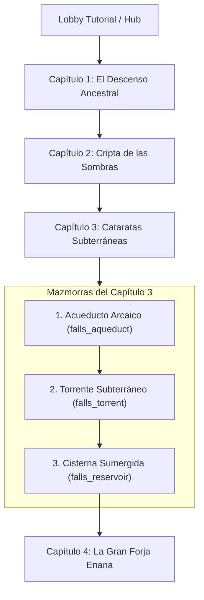

# 28. Capítulo 3: Cataratas Subterráneas y Mecánica de Torrentes Fluviales

## 1. Visión General del Capítulo 3

El **Capítulo 3: Cataratas Subterráneas** (`subterranean_falls`) expande la campaña cooperativa de *Runa y Piedra* introduciendo entornos de acueductos milenarios tallados en piedra caliza húmeda, canales de flujo rápido y cisternas subterráneas.

Con este capítulo se activa una mecánica física central en el motor del juego: **Torrentes Fluviales y Corrientes Acuáticas Direccionales** (`WATER_STREAM`), proporcionando inercia continua, aceleración de marcha, saltos de impulso y amortiguación de caídas.

---

## 2. Nueva Mecánica: Torrentes y Corrientes de Agua

### 2.1. Bloques de Vóxeles Registrados

En `src/config/constants.js` se han definido los nuevos identificadores numéricos de bloques:

| ID | Constante | Descripción | Comportamiento Físico | Tile Atlas |
|:---|:---|:---|:---|:---:|
| `14` | `BLOCK_TYPES.WATER` | Agua tranquila / estanque cristalino | No sólida, flotabilidad y amortiguación de caída | Tile 28 |
| `15` | `BLOCK_TYPES.WATER_STREAM_NORTH` | Torrente Longitudinal Norte | No sólida, empuje vectorial en $-Z$ (hacia entrada) | Tile 29 |
| `16` | `BLOCK_TYPES.WATER_STREAM_SOUTH` | Torrente Longitudinal Sur | No sólida, empuje vectorial en $+Z$ (hacia el fondo) | Tile 29 |
| `17` | `BLOCK_TYPES.WATER_STREAM_EAST` | Torrente Transversal Este | No sólida, empuje vectorial en $+X$ (hacia la derecha) | Tile 30 |
| `18` | `BLOCK_TYPES.WATER_STREAM_WEST` | Torrente Transversal Oeste | No sólida, empuje vectorial en $-X$ (hacia la izquierda) | Tile 30 |

### 2.2. Modelo Físico en `SimulationEngine.js` y `PhysicsAABB.js`

1. **Permeabilidad e Inmersión (`isSolid = false`)**:
   Los bloques de agua no colisionan como muros o suelos duros. En `PhysicsAABB.js`, `isWaterBlock(block)` evalúa verdadero para los tipos 14 a 18, excluyéndolos de `isSolid()`, permitiendo que el héroe se sumerja en canales o fosas acuáticas.

2. **Empuje Vectorial Continuo (Drift / Flujo)**:
   A 30 Hz determinista y libre de asignaciones de memoria (Zero-GC), `SimulationEngine.getWaterInteraction(player)` muestrea los vóxeles dentro del volumen del jugador y en la huella de sus pies:
   $$\vec{v}_{\text{stream}} = (v_x, v_z)$$
   La velocidad resultante se combina con el movimiento del jugador:
   $$v_x = (f_x \cdot \text{inputForward} + r_x \cdot \text{inputRight}) \cdot \text{speed} + v_{\text{stream}, x}$$
   $$v_z = (f_z \cdot \text{inputForward} + r_z \cdot \text{inputRight}) \cdot \text{speed} + v_{\text{stream}, z}$$

   - **A favor de corriente**: La velocidad de carrera y el empuje se suman ($4.8 + 4.2 = 9.0\text{ m/s}$), permitiendo saltos de longitud sobre grandes abismos.
   - **En reposo**: El jugador flota y es arrastrado de forma natural por el torrente.
   - **A contracorriente**: El avance requiere esfuerzo coordinado o apoyarse en las salientes secas de piedra caliza.

3. **Amortiguación de Caída y Flotabilidad**:
   Al caer en aguas profundas o canales de acueducto desde alturas elevadas, la velocidad vertical terminal se amortigua suavemente hacia:
   $$\text{WATER\_CUSHION\_TERMINAL\_VELOCITY} = -3.5\text{ m/s}$$
   evitando caídas bruscas y proporcionando un "efecto colchón" hidráulico.

4. **Soporte de Superficie Acuática y Prevención de Caída al Vacío**:
   En `PhysicsAABB.js`, se introdujo `isFloorOrSupport(world, bx, by, bz)` y `overlapsSupport()`. Los bloques de agua no bloquean el paso horizontal en los ejes $X$ y $Z$ (permitiendo atravesarlos libremente), pero actúan como superficie de soporte en el eje $Y$ cuando el jugador desciende ($dy < 0$). De este modo, los canales de agua en $y=0$ sustentan al jugador en $y=1.0$ con `onGround = true`, permitiendo caminar, correr y deslizarse sobre la corriente sin precipitarse al vacío del abismo inferior. Además, los mapas de nivel sellan la base del canal en $y=-1$ con sillar sólido como lecho rocoso.

5. **Salto Acuático / Natación Vertical**:
   Si el jugador se encuentra dentro del agua (`inWater = true`), puede saltar libremente para impulsarse y salir del canal hacia los andenes laterales de piedra firme.

---

## 3. Arte y Texturas en el Texture Atlas 4x8

Se crearon e integraron los sprites vectoriales en `src/render/textures/water.js`, completando las casillas 28 a 31 del atlas procedural:

- **Tile 28 (`waterCalm`)**: Agua cristalina turquesa (`#0284c7`, `#0369a1`), redes de luz caústica en arco (`#38bdf8`), destellos blancos y microburbujas translúcidas.
- **Tile 29 (`waterCurrentZ`)**: Flujo longitudinal rápido con líneas de corriente paralelas, ondas chevron direccionales (`#e0f2fe`) y espuma densa en las crestas (`#ffffff`).
- **Tile 30 (`waterCurrentX`)**: Flujo transversal rápido a lo largo del eje horizontal con estelas de espuma y vórtices laterales.
- **Tile 31 (`waterCascade`)**: Cascada efervescente con velos de agua espumosa y microgotas de rompiente.

---

## 4. Síntesis de Audio Procedural

En `src/audio/SoundManager.js` se implementó `playWaterSplash()`:
- **Componente de sumersión**: Oscilador senoidal con caída de tono de $320\text{ Hz}$ a $120\text{ Hz}$ en $0.15\text{ s}$.
- **Componente de espuma/salpicadura**: Ruido blanco estático pasado por un filtro biquad pasabanda (`bandpass`) centrado entre $800\text{ Hz}$ y $400\text{ Hz}$ ($Q = 2.0$), garantizando fidelidad sonora sin archivos externos (.mp3/.wav).

---

## 5. Diseño de Mazmorras del Capítulo 3

### 5.1. Mazmorra 1 (Intro): Acueducto Arcaico (`falls_aqueduct`)
- **Sala 1 (Canal de Entrada)**: Canal central rápido con torrente hacia el sur que acelera la llegada a la Puerta 1. Repisa de caliza con Jump Pad y Llave de la Esclusa.
- **Sala 2 (Gran Canal del Acueducto)**: Canales fluviales convergentes, corriente este transversal hacia isla con cofre de expedición (180 gemas y poción de vida) y losa mecánica de la esclusa.
- **Sala 3 (Gruta de la Cascada)**: Estanque cristalino de aguas mansas, Altar del Acueducto Arcaico y escalinata ceremonial de descenso a la segunda mazmorra.

### 5.2. Mazmorra 2 (Desafío): Torrente Subterráneo (`falls_torrent`)
- **Sala 1 (Atrio del Vórtice)**: Corriente rápida hacia el sur y Llave Fluvial en repisa oriental.
- **Sala 2 (Los Torrentes Cruzados)**: Corrientes alternas hacia el este (`WATER_STREAM_EAST`) y hacia el oeste (`WATER_STREAM_WEST`). Salto con Jump Pad para superar el foso rápido y alcanzar la losa del vórtice.
- **Sala 3 (Cámara de la Confluencia)**: Confluencia fluvial profunda, cofre de 260 gemas, Altar del Torrente y escalinata de descenso a la cisterna final.

### 5.3. Mazmorra 3 (Clímax): Cisterna Sumergida (`falls_reservoir`)
- **Sala 1 (Atrio de las Compuertas)**: Canal de acceso y Llave de la Cisterna.
- **Sala 2 (La Gran Cisterna Sumergida)**: Enorme masa de agua subterránea con corrientes periféricas, plataformas elevadas de caliza, Jump Pads de salto largo sobre el embalse y cofre con 300 gemas.
- **Sala 3 (Santuario Fluvial Supremo)**: Santuario con fosa de aguas profundas, cofre del altar con 350 gemas y el **Altar Fluvial Supremo** (`pedestalTheme: "subterranean_falls"`), sin escalinata (`stairs: null`). Consagrar el altar otorga la victoria del Capítulo 3 y desbloquea el Capítulo 4: La Gran Forja Enana.

---

## 6. Integración Visual y Temática: `subterranean_falls`

En `src/render/models/props/pedestalModel.js` y `stairsModel.js`:
- **Piedra**: Caliza húmeda azulada (`0x64748b`) y pizarra húmeda profunda (`0x334155`).
- **Acento**: Zafiro acuático radiante (`0x0ea5e9`).
- **Orbe y Niebla**: Cristal celeste (`0x0284c7`), niebla aguamarina (`0x7dd3fc`) y luz de pozo cerúlea (`0x0284c7`).

---

## 7. Verificación y Cobertura de Tests

- **Pruebas unitarias**: `tests/Chapter3WaterMechanic.test.js` cubre:
  1. Constantes y verificación de no-solidez en `PhysicsAABB`.
  2. Detección de inmersión y cálculo de empuje direccional en los 4 ejes cardinales.
  3. Arrastre horizontal y amortiguación vertical en caída libre.
  4. Salto / impulso vertical desde el agua.
  5. Carga y consistencia de los 3 niveles en `LevelRegistry`.
  6. Desbloqueo progresivo del Capítulo 3 al completar el Capítulo 2.
- **Resultados de la suite completa**: 322 tests pasando (0 fallos).
- **Compilación de producción**: Vite compila de forma limpia en 2.8s sin advertencias de tipos ni errores de empaquetado.
