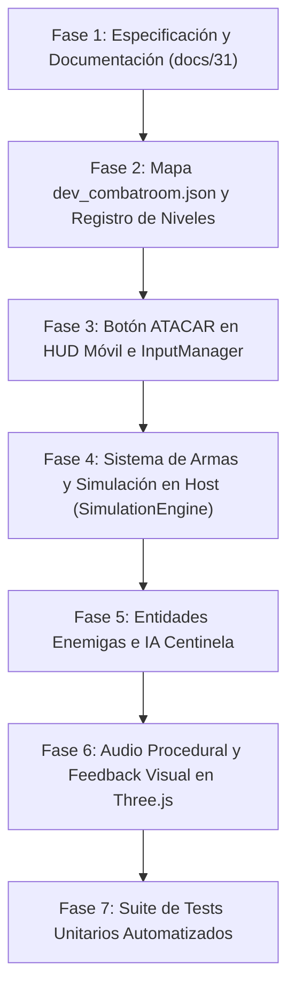

# 31. Sala de Combate de Desarrollo (CombatRoom) y Mecánica de Combate Híbrido PvE

> [!NOTE]
> Este documento técnico define la arquitectura, diseño de mecánicas, especificación de armamento por clase, controles táctiles/teclado y topología espacial de la **Sala de Combate de Desarrollo** (`dev_combatroom`) y del subsistema de combate PvE para *Runa y Piedra*, previo a cualquier modificación de código.

---

## 1. Propósito y Filosofía de Diseño

A lo largo de las versiones 1.0 a 1.41, *Runa y Piedra* consolidó su núcleo cooperativo en la exploración de mazmorras, saltos de precisión sobre lava, resolución de puertas autoritativas y apertura de cofres de botín. La introducción de combate añade una capa de dinamismo y tensión táctica sin desvirtuar la esencia cooperativa del juego.

Para evaluar y calibrar esta mecánica sin alterar la progresión ni la estabilidad de la campaña principal (`lobby_tutorial` $\to$ `dungeon_classic` $\to$ `crypt_inferno` $\to$ `abyss_throne`), se define un entorno sandbox gemelo al Showroom: la **Sala de Combate** (`dev_combatroom`).

```
                              [ Modal Herramientas Dev ]
                                          │
                    ┌─────────────────────┼─────────────────────┐
                    ▼                     ▼                     ▼
          [ Entrar al Showroom ]  [ Entrar CombatRoom ]  [ Volver al Lobby ]
                    │                     │                     │
                    ▼                     ▼                     ▼
              dev_showroom         dev_combatroom         lobby_tutorial
               (Materiales)        (Arena PvE Dev)          (Campaña)
```

### Principios Rectores:
1. **Aislamiento Absoluto de Campaña**: El nivel sólo se carga mediante invocación explícita en el modal de desarrollo (`#modal-dev`), con `isDevOnly: true` y `hiddenFromCampaign: true`.
2. **Presupuesto Móvil Estricto (60 FPS / WebGL 2.0)**:
   - Cero asignaciones de memoria por frame en el loop de combate (respeto a recolección de basura / Zero-GC).
   - Detección de colisiones mediante cajas envolventes AABB y esferas de impacto reutilizables en pool.
   - Límite estricto de entidades activas simultáneas: 4 a 6 enemigos en la arena de pruebas.
   - Menos de 30 Draw Calls globales mediante geometrías compartidas y materiales instanciados.
3. **Autoridad Absoluta del Host (Listen-Server P2P)**:
   - Los clientes envían únicamente la orden de acción de ataque con timestamp y orientación (`yaw`, `pitch`).
   - El Host valida colisiones, temporizadores de reutilización (*cooldowns*), daño infligido y estado de los enemigos.
   - Sincronización a través de paquetes binarios compactos WebRTC sin saturar el canal `unreliable` ni el `reliable`.

---

## 2. Aislamiento Estricto y Acceso al Nivel

Igual que el `dev_showroom`, el `dev_combatroom` se declara formalmente en el registro de niveles:

```json
{
  "id": "dev_combatroom",
  "name": "Sala de Combate: Pruebas PvE y Armamento",
  "difficulty": "Dev Arena",
  "isDevOnly": true,
  "hiddenFromCampaign": true
}
```

### Contrato de Integración:
* **`LevelRegistry.js`**: `getAllLevels(false)` excluye `dev_combatroom`. Sólo `getAllLevels(true)` lo incluye para herramientas de desarrollo.
* **`SessionManager.js`**: Métodos `startDevCombatRoomSession()` y `switchLevel('dev_combatroom', isHost)`.
* **`DevModal.js`**: Botones dedicados con estética Sumi-e Hanko:
  - `#btn-dev-enter-combatroom`: Inicializa la arena de combate o teletransporta a la party.
  - `#btn-dev-exit-combatroom`: Retorna al campamento base (`lobby_tutorial`).
* **Game Over y Caídas**: Si un héroe perece en la arena de combate, reaparece en la losa rúnica de spawn de la propia arena sin romper la sesión de pruebas.

---

## 3. Topología de la Sala de Combate (`dev_combatroom`)

El mapa aprovecha las dimensiones estándar de $24 \times 16 \times 36$ bloques ($864\text{ m}^2$), distribuyendo el espacio en tres sectores diferenciados mediante desniveles de cantería y arcos de piedra:

```
 z=0 ┌──────────────────────────────────────────────┐
     │ SECTOR 1: Santuario y Armería                │
     │  - Losa de Respawn azul cian (Spawn point)   │
     │  - Pedestales con armas de muestra           │
     │  - Cofres con pociones de salud              │
z=10 ├══════════════════════════════════════════════┤ Muro divisorio bajo / Umbral
     │ SECTOR 2: Zona de Blancos Estáticos          │
     │  - Muñecos de entrenamiento (Training Dummies│
     │  - Medición de daño por segundo (DPS)        │
     │  - Test de alcance melee y trayectoria balíst│
z=20 ├══════════════════════════════════════════════┤ Reja rúnica o fosa perimetral
     │ SECTOR 3: Arena de Combate Activa (PvE)      │
     │  - 3 Gárgolas / Esqueletos de Basalto (IA)   │
     │  - Plataformas de cobertura y jump pad táctico│
     │  - Fosa de lava de castigo perimetral        │
     │  - Palanca de respawn de enemigos            │
z=36 └──────────────────────────────────────────────┘
```

1. **Sector 1: Armería y Zona Segura ($z = 1$ a $9$):**
   - Suelo de baldosa pulida (`FLOOR_STONE`), iluminación ambiental clara.
   - Sin amenazas activas. Permite familiarizarse con la cadencia de ataque de la clase activa y alternar de personaje si se desea.
2. **Sector 2: Galería de Blancos Estáticos ($z = 10$ a $19$):**
   - Contiene 3 muñecos de entrenamiento indestructibles con cajas AABB fijas.
   - Al recibir impactos, emiten un flash de color bermellón y generan un feedback sonoro procedimental de madera/piedra golpeada, mostrando en telemetría el daño y distancia del impacto.
3. **Sector 3: Arena de Combate PvE Dinámico ($z = 20$ a $35$):**
   - Recinto cerrado con pilares de cobertura (`PILLAR`) y un *Jump Pad* central para pruebas de combate aéreo.
   - Spawners de 3 autómatas centinela con patrones de patrulla, detección por cono de visión y acometida.

---

## 4. Sistema de Armamento Canónico de los 5 Héroes

Cada héroe posee un arma representativa de su identidad, rol cooperativo y estadísticas de físicas:

```
┌─────────────────┬──────────────────────┬─────────────┬──────────────┬────────────┬────────────────────────┐
│ Héroe           │ Arma Canónica        │ Tipo        │ Alcance / Vel│ Cadencia   │ Efecto Secundario      │
├─────────────────┼──────────────────────┼─────────────┼──────────────┼────────────┼────────────────────────┤
│ 🧭 Aventurero   │ Espada de Explorador │ Melee Ligero│ 1.80 m       │ 0.35 s     │ Daño equilibrado (1 HP)│
│ 🛡️ Paladín      │ Mandoble de la Luz   │ Melee Pesado│ 2.20 m (180°)│ 0.65 s     │ Knockback 2.5 m (2 HP) │
│ 🪶 Explorador   │ Arco Rúnico del Viento│ Rango Proy. │ 16 m / 22 m/s│ 0.40 s     │ Proyectil rápido (1 HP)│
│ 🪄 Hechicero    │ Báculo de Rayo Arcano│ Rango Mágico│ 12 m / 14 m/s│ 0.55 s     │ Daño en área 1.2m(2 HP)│
│ 👑 Guardián     │ Mazo Sísmico Basalto │ Melee Onda  │ 2.00 m (360°)│ 0.75 s     │ Aturdimiento 0.8s(2 HP)│
└─────────────────┴──────────────────────┴─────────────┴──────────────┴────────────┴────────────────────────┘
```

### Especificación Detallada por Clase:

### 1. Aventurero (`adventurer`): Espada Corta de Explorador
* **Naturaleza:** Arma ágil cuerpo a cuerpo forjada en hierro templado.
* **Mecánica:** Golpe rápido en arco frontal estrecho ($60^\circ$) frente al cursor.
* **Tiempo de reutilización:** $350\text{ ms}$.
* **Daño:** $1\text{ punto}$ por impacto.
* **Efecto cinemático:** Empuje leve hacia atrás ($0.8\text{ m}$) sin desestabilizar la posición del objetivo.

### 2. Paladín (`paladin`): Mandoble de la Luz Radiante
* **Naturaleza:** Espadón ceremonial pesado a dos manos.
* **Mecánica:** Barrido horizontal de gran amplitud ($180^\circ$) que impacta a múltiples enemigos simultáneamente al frente.
* **Tiempo de reutilización:** $650\text{ ms}$.
* **Daño:** $2\text{ puntos}$ por golpe directo.
* **Efecto cinemático:** Gran fuerza de retroceso (*knockback* de $2.5\text{ m}$), alejando a los enemigos de la vanguardia.

### 3. Explorador (`ranger`): Arco Rúnico Silvestre
* **Naturaleza:** Ataque a distancia con proyectil balístico recto.
* **Mecánica:** Dispara una flecha rúnica veloz ($22\text{ m/s}$) alineada con el vector director de la cámara (`pitch`, `yaw`).
* **Tiempo de reutilización:** $400\text{ ms}$.
* **Daño:** $1\text{ punto}$ en impacto directo.
* **Trayectoria:** Proyectil de colisión puntual contra la geometría vóxel o cajas AABB de enemigos, con desaparición inmediata tras impacto.

### 4. Hechicero (`wizard`): Báculo de Rayo Arcano
* **Naturaleza:** Proyectil mágico esférico de plasma violeta (`#a855f7`).
* **Mecánica:** Disparo de orbe arcano a velocidad moderada ($14\text{ m/s}$) con suave estela luminosa.
* **Tiempo de reutilización:** $550\text{ ms}$.
* **Daño:** $2\text{ puntos}$ al impactar, con una pequeña onda de choque de radio $1.2\text{ m}$ que afecta a blancos cercanos.
* **Sinergia vertical:** Ideal para atacar desde plataformas superiores gracias a su habilidad de levitación.

### 5. Guardián (`guardian`): Mazo Sísmico de Basalto
* **Naturaleza:** Golpe contundente contra el suelo rocoso.
* **Mecánica:** Impacto sísmico frontal radial que barre un radio de $2.0\text{ m}$ en torno al héroe.
* **Tiempo de reutilización:** $750\text{ ms}$.
* **Daño:** $2\text{ puntos}$ de daño aplastante.
* **Efecto secundario:** Aturdimiento temporal del enemigo ($800\text{ ms}$) que bloquea su movimiento, protegiendo a los aliados.

---

## 5. Controles y Experiencia de Usuario (UI/UX)

Para preservar la fluidez de navegación táctil y de escritorio, se integra un **botón independiente de ataque** con identidad visual propia:

```
        ┌────────────────────────────────────────────────────────┐
        │                        PANTALLA                        │
        │                                                        │
        │  [ JOYSTICK VIRTUAL ]               (⚔️ ATACAR)         │
        │      (Nipple.js)                  (E USAR)   (SALTAR)  │
        └────────────────────────────────────────────────────────┘
```

### 1. Botón Táctil en Móvil (`#btn-attack`):
* **Identidad Sumi-e Pixel Art:** Sello octogonal bermellón carmesí (`#991b1b` con bisel `#dc2626` y sombra de tinta sólida).
* **Iconografía:** Icono vectorial SVG de espada cruzada (`icon_attack.svg`).
* **Ubicación ergonómica:** Posicionado en el clúster inferior derecho, inmediatamente sobre el botón `USAR` y a la izquierda de `SALTAR`, permitiendo pulsación con el pulgar derecho sin obstruir la vista.
* **Retroalimentación táctil:** Animación CSS de prensado (`transform: scale(0.92)`) y feedback sonoro procedural instantáneo.

### 2. Atajos de Escritorio (Teclado y Ratón):
* **Click Izquierdo del Ratón:** Ataque principal (cuando el puntero está bloqueado por PointerLock).
* **Tecla `F`:** Atajo de teclado directo para atacar en cualquier momento.
* **Tecla `J`:** Opción de ataque para esquemas de control alternativos con ambas manos en el teclado.

### 3. Actualización de la Guía de Controles (`#controls-guide`):
* Se añade una fila explicativa en el panel superpuesto (`H`):
  - **Teclado:** `[Clic Izq / F] Atacar con arma de clase`.
  - **Móvil:** `[Botón ATACAR] Golpear o disparar proyectil`.

---

## 6. Arquitectura de Enemigos PvE y Lógica de Simulación

Para garantizar que los enemigos respeten el presupuesto móvil (Zero-GC y 60 FPS estables), se implementa un modelo de entidad ligera: `CombatEntity` o `EnemyCentinel`.

### Máquina de Estados Finitos (FSM) de Enemigos:
1. **`IDLE` (Inactivo / Guardia):** Permanece en su punto de spawn observando el entorno en un radio de visión de $8\text{ metros}$.
2. **`CHASE` (Persecución directa):** Al detectar a un jugador en su cono frontal sin obstáculos vóxel intermedios, se desplaza hacia él a $2.5\text{ m/s}$ usando colisiones AABB simples.
3. **`ATTACK` (Acometida):** Al estar a menos de $1.4\text{ m}$, detiene su avance y realiza un embate frontal tras $400\text{ ms}$ de anticipación visual (parpadeo en blanco). Si conecta, sustrae 1 corazón al jugador y activa sus ticks de invulnerabilidad (`invulnTicks = 60`).
4. **`HURT` (Impacto recibido):** Animación de retroceso, destello rojo y breve parálisis ($300\text{ ms}$).
5. **`DEAD` (Derrotado):** Se disuelve en partículas de polvo de cantería y suelta botín de prueba (gemas o una poción de vida).

### 6.1 Reglas de correctitud del combate

Estas reglas se aplican de forma autoritativa en los gestores y están cubiertas por `tests/combat-correctness.test.js`:

| Regla | Comportamiento | Constante / módulo |
|---|---|---|
| **Línea de visión** | El melee, las explosiones AoE y los proyectiles no atraviesan muros ni columnas. | `src/combat/combatGeometry.js` (`hasLineOfSight`) |
| **Altura de agro** | Un enemigo terrestre ignora objetivos con más de $2.5\text{ m}$ de desnivel. | `COMBAT_TUNING.verticalAggroTolerance` |
| **Altura de ataque** | Solo conecta golpes con un desnivel de hasta $1.25\text{ m}$ (evita golpear a través de plataformas). | `COMBAT_TUNING.verticalAttackTolerance` |
| **Anti-stunlock** | Tras aplicar un aturdimiento, el enemigo es inmune a nuevos stuns durante $2\text{ s}$. | `COMBAT_TUNING.stunImmunityMs` |
| **Colisión continua** | Los proyectiles muestrean el tramo recorrido cada $0.25\text{ m}$, sin tunneling en frames largos. | `ProjectilePool` + `traceSolidSegment` |
| **Separación** | Los enemigos se repelen para no apilarse sobre el mismo punto, sin romper la persecución. | `EnemyNavigation` (`computeSeparation`) |

> La navegación (persecución, wall-sliding, whiskers y separación) vive en `src/combat/EnemyNavigation.js`, y el ciclo de vida de los proyectiles en `src/combat/ProjectilePool.js`, para mantener `BaseEnemy` y `CombatManager` por debajo del límite de 500 líneas del guardarraíl.

---

## 7. Protocolo de Red WebRTC y Sincronización Listen-Server

El sprint cooperativo implementa el modelo **listen-server** en `src/combat/CombatSync.js`:
el anfitrión simula la IA, los proyectiles y **todo el daño**; los invitados solo envían
su **intención de ataque** y renderizan los eventos y snapshots del host. Los mensajes
viven en `src/combat/CombatProtocol.js` (módulo aparte porque `Protocol.js` está en la
deuda congelada del guardarraíl de 500 líneas; los opcodes 0x00–0x13 ya estaban ocupados).

### Opcodes de Combate (`COMBAT_MSG`):

* **`0x14 - PLAYER_ATTACK` (Cliente $\to$ Host, 11 bytes, canal safe):**
  - `[0]` `Uint8`: `0x14`
  - `[1..2]` `Uint16`: `attackSeq` (contador rotativo anti-duplicados por jugador)
  - `[3..6]` `Float32`: `yaw` (orientación horizontal)
  - `[7..10]` `Float32`: `pitch` (elevación vertical para flechas/magia)

* **`0x15 - COMBAT_EVENT` (Host $\to$ Todos, 26 bytes, canal safe):**
  - `[0]` `Uint8`: `0x15`
  - `[1]` `Uint8`: `kind` (`1` ataque ejecutado, `2` impacto en enemigo, `3` golpe de enemigo a jugador, `4` enemigo derrotado, `5` impacto en maniquí)
  - `[2]` `Uint8`: `actorId` (id del jugador autor del evento, `255` = desconocido)
  - `[3]` `Uint8`: `targetId` (índice de enemigo o id de jugador según `kind`)
  - `[4]` `Uint8`: `weaponCode` (índice canónico en `WEAPON_CODE_ORDER`, `255` = n/a)
  - `[5..20]` `Float32 × 4`: `x`, `y`, `z`, `yaw` (posición del actor o del blanco)
  - `[21..24]` `Float32`: `pitch`
  - `[25]` `Uint8`: `value` (para `HIT_ENEMY`: vida **restante**; para `ENEMY_ATTACK`: daño; saturado a `[0, 255]`)

* **`0x16 - ENEMY_SNAPSHOT` (Host $\to$ Todos, 4 + N × 20 bytes, canal hot a 10 Hz):**
  - `[0]` `Uint8`: `0x16`
  - `[1..2]` `Uint16`: `seq` rotativo (un paquete perdido lo reemplaza el siguiente)
  - `[3]` `Uint8`: `count` (N enemigos)
  - Por enemigo (20 bytes): `index:1`, `x/y/z/yaw: Float32 × 4`, `hp:1`, `maxHp:1`, `state:1` (`idle/chase/telegraph/hurt/dead` codificados con `ENEMY_STATE_ORDER`).

Con 5 enemigos el snapshot mantiene el canal hot por debajo de $1\text{ KB/s}$.

### 7.1 Flujo cooperativo (autoridad del anfitrión)

| Paso | Actor | Mecanismo |
|---|---|---|
| 1 | Invitado | `CombatSync.requestAttack()`: cooldown local (`player.canAttack`) y envío de `PLAYER_ATTACK` con `seq` |
| 2 | Host | `handlePlayerAttack()`: deduplica `seq`, valida conexión (`playerManager.getPlayerByConnection`) y vidas; resuelve con `CombatManager.executePlayerAttack` usando la **posición autoritativa** del jugador y el yaw/pitch recibidos (pitch clampeado a $\pm1.5$) |
| 3 | Host | Difunde `COMBAT_EVENT(ATTACK)`; los enemigos golpeados generan `HIT_ENEMY`/`ENEMY_DEFEAT` vía los callbacks `onEnemyHit`/`onEnemyDefeated` de `EnemyManager` |
| 4 | Cliente | `handleCombatEvent()`: aplica `applyRemoteHit`/`applyRemoteDefeat`, reproduce sonido y mensaje solo si el actor es el jugador local, y lanza proyectiles **visuales** (`spawnVisualProjectile`) |
| 5 | Host | `broadcastEnemySnapshot()` a 10 Hz por canal hot; un late-joiner recibe estado completo vía `sendStateTo()` durante el handshake `peer-joined` |
| 6 | Cliente | `enemyManager.applySnapshot()`: posiciona enemigos, marca muertos y enciende flash si baja la vida; **no ejecuta IA ni daño** (`CombatManager.authoritative = false`) |

Los índices de enemigos son **estables** entre réplicas porque todos los clientes
generan los enemigos desde el mismo `dev_combatroom.json` en el mismo orden (`switchLevel`),
y la vida de los jugadores remotos se sincroniza con el campo `lives` del `SNAPSHOT`
existente (el mensaje y el sonido local se disparan con `COMBAT_EVENT(ENEMY_ATTACK)`).

### 7.2 Entrada a la sala cooperativa

El botón **Entrar a Sala de Combate PvE** del modal Dev ofrece dos modos cuando no hay
sesión activa: **Sala Cooperativa (PIN)** — `startCoopCombatRoomSession()` en
`DevToolsMixin.js`, que crea una sala real con PIN y carga la arena difundiendo el cambio
de nivel — o **Sesión Local Dev** (sin red, comportamiento previo). Con una sesión ya
activa, el anfitrión puede cambiar a la arena con `switchLevel('dev_combatroom', true)`.

---

## 8. Hoja de Ruta de Implementación Técnica



1. **Fase 1 (Completada):** Documentación exhaustiva en `docs/31-sala-de-combate-dev-y-mecanica-hibrida-pve.md` y actualización del índice `docs/README.md`.
2. **Fase 2:** Creación de `src/levels/data/dev_combatroom.json`, registro en `LevelRegistry.js` y enlaces en `DevModal.js` y `SessionManager.js`.
3. **Fase 3:** Integración del botón `#btn-attack` en el DOM (`index.html`), estilos Sumi-e (`sumie-ui.css`) y captura de eventos en `InputManager.js`.
4. **Fase 4:** Definición de armas por clase en `HeroRegistry.js` / `Player.js` y resolución autoritativa de ataques en `SimulationEngine.js`.
5. **Fase 5:** Creación de `CombatManager.js` para muñecos de prueba y autómatas centinela PvE con pool de proyectiles Zero-GC.
6. **Fase 6:** Síntesis sonora de golpeo (`playSwordSwing()`, `playBowShot()`, `playSpellCast()`, `playHit()`) en `SoundManager.js`.
7. **Fase 7 (Completada):** Pruebas unitarias en `tests/` cubriendo colisiones de ataque, cooldowns y aislamiento del mapa.
8. **Fase 8 (Completada):** Sprint de correctitud PvE: línea de visión, altura de agro/ataque, anti-stunlock, colisión continua de proyectiles y separación entre enemigos (§6.1, `tests/combat-correctness.test.js`).
9. **Fase 9 (Completada):** Sprint cooperativo: `CombatProtocol.js` (0x14/0x15/0x16), `CombatSync.js` con autoridad del anfitrión, réplica de enemigos por índice estable, entrada `PLAYER_ATTACK` con deduplicación `seq`, snapshots a 10 Hz y suite `tests/coop-combat.test.js`.
